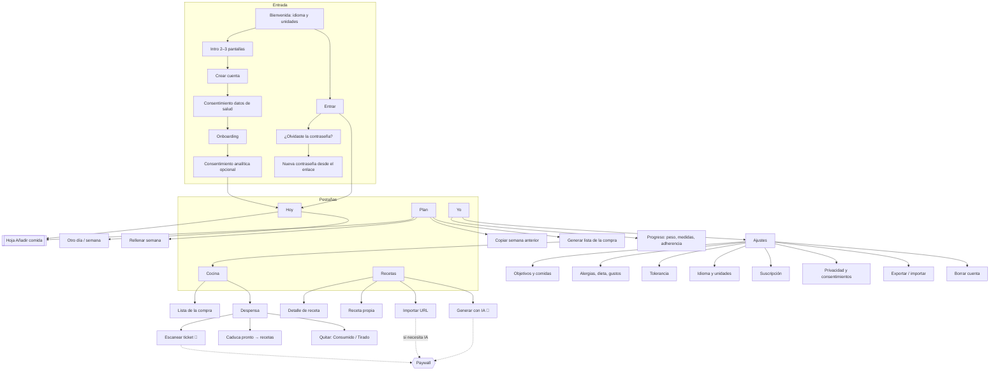
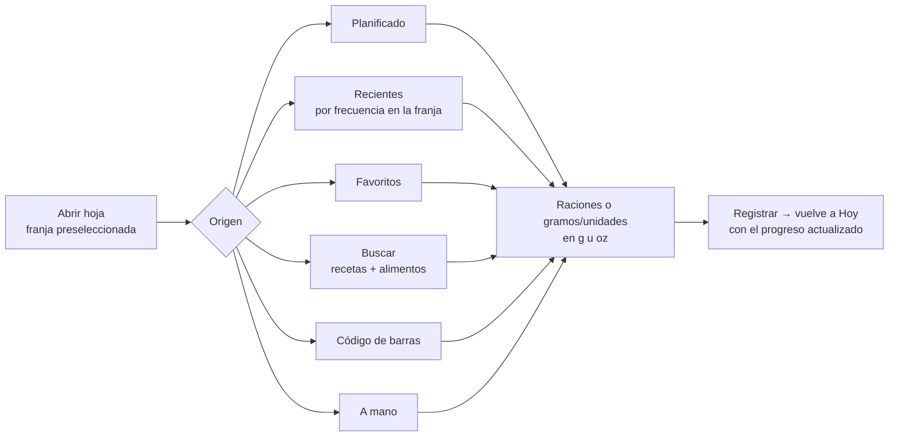
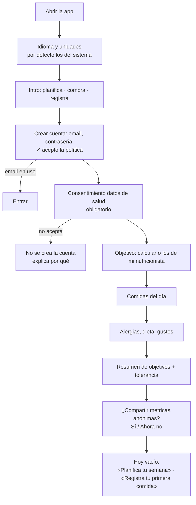
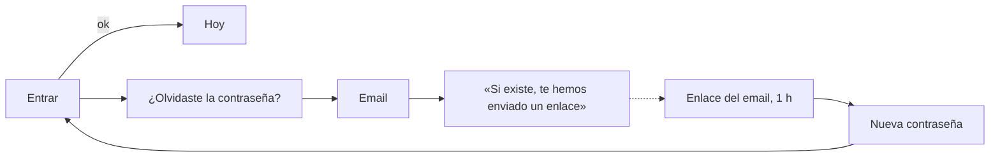
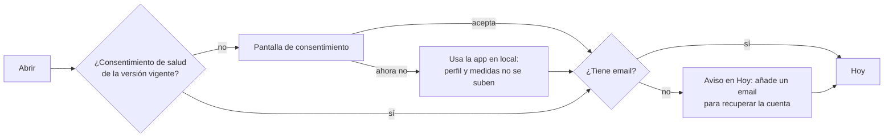
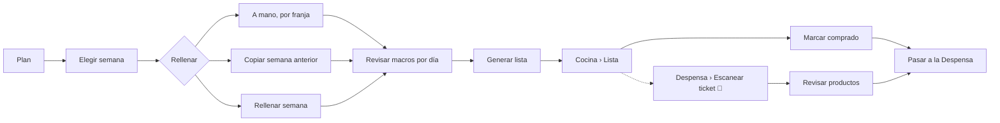
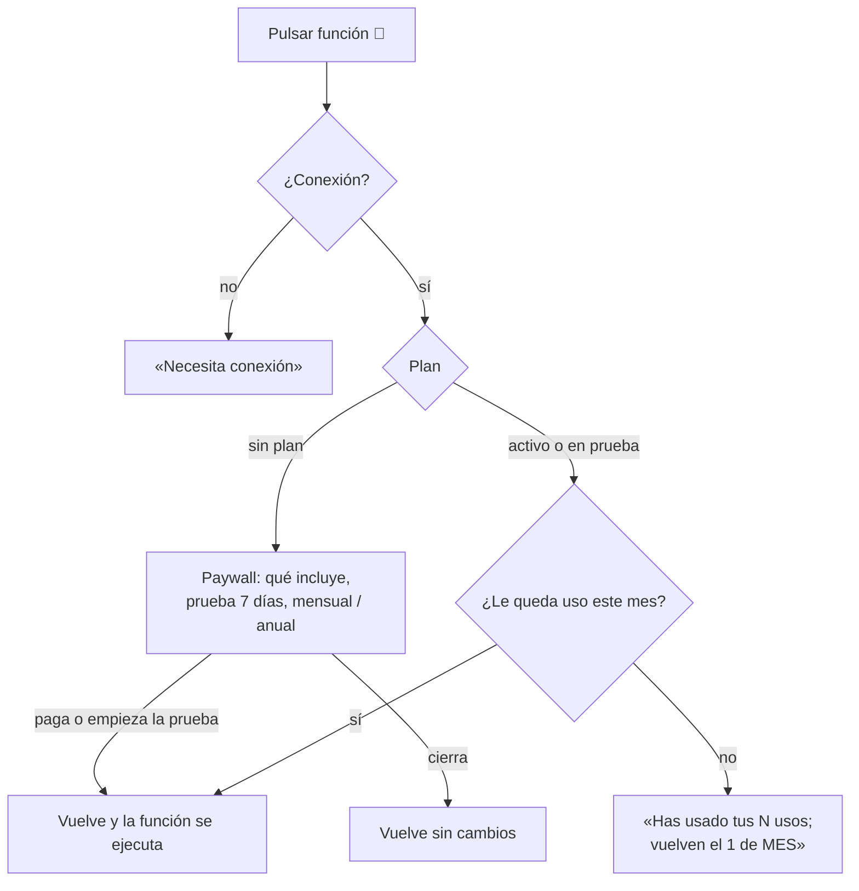

# MealPlan, el producto: App flow
_Status: Draft · Updated: 2026-11-13_
_Related: [spec](spec.md) · [tech](tech.md) · [brief](brief.md)_

## TL;DR
Mapa de pantallas y flujos de MealPlan diseñado desde cero a partir del PRD y la tech design, sin partir de la app actual. Cinco pestañas siguen el ciclo del producto: **Hoy** (inicio y registro), **Plan**, **Cocina** (Compra + Despensa), **Recetas** y **Yo** (progreso y ajustes). Registrar una comida se hace siempre desde una misma hoja, **Añadir comida**. Hay que tener cuenta antes de usar la app, y cualquier función de IA pasa por el paywall.

## Decisiones (usuario, 2026-11-13)
- **D1.** Cinco pestañas: Hoy · Plan · Cocina · Recetas · Yo.
- **D2.** La pantalla de inicio es **Hoy**.
- **D3.** Lista de la compra y Despensa juntas en **Cocina**.
- **D4.** Hay que registrarse antes de usar la app: no hay uso anónimo.
- **D5.** Entregable: solo este documento, sin prototipo.

## Mapa de pantallas

💎 = función de pago (R15). «Rellenar semana» es gratis (F1).

## Pestañas

### 1. Hoy (inicio)
- **Cabecera:** fecha y selector de día (deslizar o tocar para abrir el calendario). Tira semanal con los días que cumplen (R2).
- **Progreso del día:** kcal y macros frente al objetivo, usando la tolerancia de «cumplido» (R1).
- **Franjas del día** (las comidas que el usuario eligió en el onboarding). Cada una muestra:
  - lo planificado, con **«Registrar»** de un toque (del Plan al Diario);
  - lo ya registrado, donde se puede editar los gramos, repetir o borrar;
  - **«+ Añadir»**, que abre la hoja Añadir comida con esa franja ya elegida.
- **Agua y fibra:** contadores rápidos.
- **Avisos:** «3 alimentos caducan pronto» lleva a Cocina › Despensa filtrada.
- **Menú del día:** copiar este día a otra fecha (R2), y deshacer la copia (R27).
- **Semana:** gráfica semanal y medias de adherencia (también desde Yo › Progreso).

### 2. Plan
- Rejilla semana × franjas, con navegación entre semanas (botones o deslizar, R29).
- Cada día muestra sus macros planificados frente al objetivo.
- En una franja: elegir receta o alimento con raciones, marcar sobras o batch cooking, mover y borrar.
- Acciones de semana: **Rellenar semana** (gratis), **Copiar semana anterior**, **Generar lista de la compra** (lleva a Cocina › Lista).

### 3. Cocina
Control segmentado **Lista | Despensa**.
- **Lista de la compra:** se genera desde el Plan descontando lo que hay en la Despensa, agrupada por categoría. Al marcar algo como comprado → **«Pasar a la Despensa»** (pide la caducidad si no se puede inferir).
- **Despensa:** inventario por categoría con chips «Caduca pronto» y «Caducado», y «caduca en X días» en la tarjeta (R30).
  - **Escanear ticket 💎:** cámara → revisar los productos detectados → guardar.
  - **Caduca pronto → recetas:** recetas que aprovechan lo que caduca.
  - **Quitar:** elegir «Consumido» o «Tirado» (R19).

### 4. Recetas
- Búsqueda, filtros (temporada, alérgenos, valoración, favoritos, propias) y orden.
- **Detalle:** ingredientes según las raciones, macros, aviso de alérgenos, valoración 1–5 y favorito. Acciones: **Añadir al Plan**, **Registrar ahora**.
- **Crear:** receta propia · importar desde URL (💎 solo si hace falta la IA) · **Generar con IA 💎** según el perfil y la despensa.
- Frutas y verduras de temporada (R5).

### 5. Yo
- **Progreso:** peso y medidas con gráfica y «+ Nueva medición», medias de adherencia e histórico semanal.
- **Ajustes:**
  - Objetivos: calculados (Mifflin-St Jeor) o los del nutricionista, con la proteína como rango.
  - Comidas del día, alergias (exclusión estricta), dieta y gustos, tolerancia de «cumplido».
  - Idioma y unidades (R20, R21).
  - Suscripción: plan, uso de IA del mes con su fecha de reinicio, gestionar o cancelar.
  - Avisos (R18): recordatorios de comidas y caducidades.
  - Privacidad: política, consentimiento de analítica activable y desactivable, datos de salud (informativo: es obligatorio para tener cuenta).
  - Datos: exportar e importar JSON, estado de la sincronización.
  - Cuenta: email, cambiar contraseña, cerrar sesión, **borrar cuenta**.

## Hoja «Añadir comida»
Es el flujo más usado (G2): se abre desde Hoy, desde una franja de Hoy y desde una franja del Plan.

- Lo planificado y los recientes se registran con un toque, sin pasar por la cantidad, que se puede editar después.
- Desde el Plan, la misma hoja **asigna** a la franja en lugar de registrar.
- Combinar varios alimentos en un plato (R25) es una acción dentro de A mano o de Buscar.

## Flujos

### F-1. Primera vez desde la tienda (R10, R13, R20–R22)

- La política de privacidad se puede abrir desde Bienvenida y desde Crear cuenta, antes de registrarse.
- Hasta aceptar el consentimiento de salud no se envía nada de salud al servidor.

### F-2. Volver a entrar y recuperar la contraseña (R11)

### F-3. Cuentas existentes al actualizar (R13, F2, F3)

### F-4. Planificar la semana y comprar (R3, R4, R6)

### F-5. Registrar una comida (R2, R3)
- **Lo planificado:** Hoy → franja → «Registrar» (un toque).
- **Otra cosa:** Hoy → «+ Añadir» → hoja Añadir comida.
- **Desde una receta:** Recetas → detalle → «Registrar ahora» → elegir franja y raciones.

### F-6. Revisar (R2, R7)
Hoy › tira semanal y gráfica · Yo › Progreso (peso, medidas, adherencia).

### F-7. Paywall y límite de IA (R14, R15)

- El estado del plan y del uso viene del servidor (`GET /api/me`), nunca de una caché local.
- Restaurar compras está en Yo › Suscripción y en el paywall.

### F-8. Quitar de la Despensa (R19)
Despensa → ítem → «Quitar» → **Consumido** / **Tirado** → se guarda con la fecha. Al deslizar el ítem aparecen las dos opciones directamente.

### F-9. Borrar la cuenta (R12)
Yo › Ajustes › Cuenta › Borrar cuenta → explica qué se borra y que la suscripción de la tienda se cancela aparte → escribir la contraseña → confirmar → sesión cerrada → Bienvenida. Los datos locales de ese dispositivo se borran también.

### F-10. Avisos (R18)
- Recordatorio de comida → abre Hoy en esa franja.
- Aviso de caducidad → abre Cocina › Despensa filtrada por «Caduca pronto».

## Estados transversales
| Estado | Comportamiento |
|---|---|
| Sin conexión | Todo funciona con los datos del dispositivo salvo la IA, el código de barras de productos nuevos, importar URL, el login y la sincronización. Esas acciones se ven, desactivadas, con «Necesita conexión». Un indicador discreto en la cabecera muestra si hay cambios pendientes de sincronizar. |
| Conflicto de sincronización (R16) | Aviso no bloqueante: «Se han combinado cambios de otro dispositivo», con detalle en Yo › Datos. |
| Sesión caducada o cuenta borrada en otro dispositivo | En la siguiente sincronización → Entrar; los datos locales se conservan. |
| Vacíos | Hoy sin plan: «Planifica tu semana». Plan vacío: tres botones para rellenar. Despensa vacía: «Marca la compra o escanea un ticket». Recetas sin favoritos: sugerencia de temporada. |
| Alergias | Las recetas con alérgenos declarados no aparecen en búsquedas, sugerencias ni en Rellenar semana; si llegan por URL o IA, se muestra un aviso. |
| Idioma y unidades | Cambian al momento en toda la app; los valores guardados no cambian. |

## Fuera de este app flow
- Vista para nutricionistas (R31): necesita su propia spec.
- Azúcar y sodio (R24): son campos dentro de la hoja y del progreso, no cambian el flujo.

## Cobertura del PRD
| Req | Dónde |
|---|---|
| R1 | F-1 onboarding · Yo › Ajustes |
| R2 | Hoy · Añadir comida · F-5 |
| R3 | Plan · F-4 |
| R4, R6 | Cocina · F-4 · F-8 |
| R5 | Recetas |
| R7 | Yo › Progreso |
| R8, R16 | Yo › Datos · estados transversales |
| R9, R17 | Estados «Sin conexión» |
| R10, R11, R13 | F-1 · F-2 · F-3 |
| R12 | F-9 |
| R14, R15 | F-7 · Yo › Suscripción |
| R18 | F-10 · Yo › Avisos |
| R19 | F-8 |
| R20, R21 | Bienvenida · Yo › Idioma y unidades |
| R22 | Mismo flujo en web, iOS y Android |
| R23 | F-1 (consentimiento de analítica) · Yo › Privacidad |
| R25–R30 | Añadir comida · Hoy · Plan · Despensa |

## Open questions
- [ ] ¿La intro de 2–3 pantallas aporta o se salta directamente a Crear cuenta?
- [ ] ¿Cuándo se ofrece la prueba de 7 días fuera del paywall (por ejemplo, al acabar el onboarding)?
- [ ] En la web, ¿las pestañas van como barra inferior o lateral en pantallas anchas?
