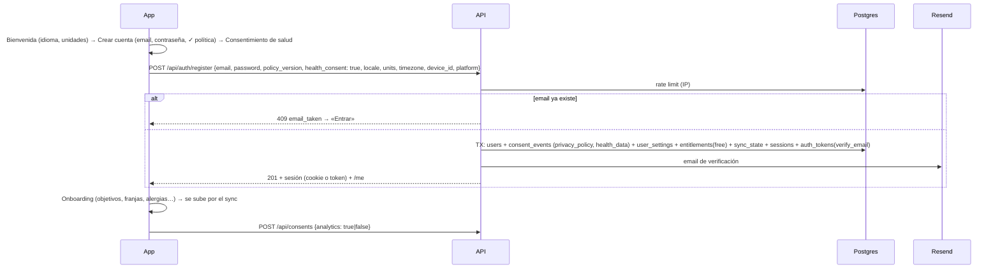
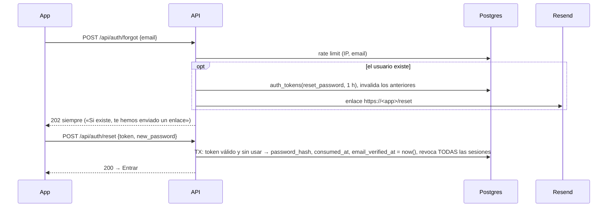

# MealPlan, el producto: Modelo de datos y autenticación
_Status: Draft · Updated: 2026-11-13_
_Related: [spec](spec.md) · [tech](tech.md) · [app flow](appflow.md) · [design brief](design-brief.md)_

## TL;DR
Esquema del servidor diseñado desde cero a partir del PRD, la tech design y el app flow, sin partir del código actual. Postgres (Neon) con **tablas normalizadas por entidad** en lugar de un JSON por clave: así el servidor puede fusionar por fila (R16), filtrar datos de salud por consentimiento (R13), borrar en cascada (R12) y calcular métricas con SQL (R23). La app sigue siendo *offline-first*: cada fila nace en el dispositivo con un UUID y se sincroniza con un cursor de revisión por usuario. La autenticación es propia: email + contraseña (argon2id), sesiones opacas guardadas como hash (cookie `httpOnly` en la web, *bearer* en las apps nativas), tokens de un solo uso por email para verificar y recuperar, y un registro de consentimientos versionado.

Las decisiones marcadas **D#** las confirmó el dueño del producto el 2026-11-13 (§9).

## 1. Principios
1. **Normalizado y tipado.** Una tabla por entidad, con `CHECK` en los enumerados. Nada de blobs JSON salvo lo que de verdad es un documento (pasos de una receta, cuerpo de un webhook). **(D1)**
2. **Offline-first.** Toda fila del usuario tiene un `id` UUIDv7 generado en el cliente, así se crea sin conexión y el orden por id es cronológico.
3. **Métrico siempre.** Gramos, mililitros, kg y cm en la base; las unidades imperiales son solo de vista e introducción (R21).
4. **El día es local.** El Diario y el Plan usan `date` (día del usuario en su zona horaria), nunca `timestamptz`.
5. **Instantáneas en el Diario.** Una entrada guarda los macros que tenía al registrarse; corregir un alimento no reescribe el pasado.
6. **Catálogo y datos del usuario en la misma tabla.** `foods` y `recipes` tienen `owner_id`: `NULL` = catálogo (semilla traducible), un usuario = dato propio (no se traduce, R20). Una sola FK para referenciar cualquiera de los dos.
7. **Borrar la cuenta = un `DELETE`.** Toda tabla con datos de un usuario cuelga de `users` con `ON DELETE CASCADE` (R12).
8. **Salud separada.** Los datos que el RGPD trata como categoría especial viven en tablas propias (marcadas 🩺) y el servidor rechaza escribir en ellas sin el consentimiento `health_data` vigente (R13).

## 2. Mapa de entidades

```mermaid
erDiagram
  users ||--o{ sessions : "inicia"
  users ||--o{ auth_tokens : "recibe"
  users ||--o{ consent_events : "da o retira"
  users ||--|| entitlements : "tiene"
  users ||--o{ billing_events : ""
  users ||--o{ ai_usage : "consume"
  users ||--|| sync_state : ""
  users ||--o{ push_endpoints : ""
  sessions ||--o{ push_endpoints : ""

  users ||--|| user_settings : ""
  users ||--o| health_profiles : "🩺"
  users ||--o{ nutrition_targets : "🩺 por fecha"
  users ||--o{ user_allergens : "🩺"
  users ||--o{ body_measurements : "🩺"
  users ||--o{ food_preferences : ""
  users ||--o{ meal_slots : "define"

  users ||--o{ foods : "propios (owner_id)"
  users ||--o{ recipes : "propias (owner_id)"
  foods ||--o{ food_names : "catálogo: por idioma"
  foods ||--o{ food_portions : ""
  foods ||--o| seasonal_produce : ""
  recipes ||--o{ recipe_texts : "catálogo: por idioma"
  recipes ||--o{ recipe_ingredients : ""
  foods ||--o{ recipe_ingredients : ""
  users ||--o{ recipe_marks : "favorito, valoración"
  recipes ||--o{ recipe_marks : ""
  users ||--o{ food_favorites : ""
  foods ||--o{ food_favorites : ""

  meal_slots ||--o{ plan_items : ""
  meal_slots ||--o{ diary_entries : ""
  plan_items ||--o{ diary_entries : "registrado desde"
  plan_items ||--o{ plan_items : "sobras de"
  recipes ||--o{ plan_items : ""
  foods ||--o{ plan_items : ""
  recipes ||--o{ diary_entries : ""
  foods ||--o{ diary_entries : ""
  users ||--o{ day_logs : "agua"

  users ||--o{ shopping_items : ""
  users ||--o{ pantry_items : ""
  foods ||--o{ shopping_items : ""
  foods ||--o{ pantry_items : ""
  shopping_items ||--o| pantry_items : "pasa a"
```

Tablas que no cuelgan de ningún usuario: `rate_limit_buckets` (claves con HMAC) y `metrics_daily` (solo agregados).

## 3. Convenciones

### Columnas de sincronización
Toda tabla marcada **⇅** se sincroniza con los dispositivos y lleva este bloque, que no se repite en las tablas de abajo:

| Columna | Tipo | Notas |
|---|---|---|
| `id` | `uuid` PK | UUIDv7 generado en el cliente. En tablas con clave natural, UUIDv5 determinista (ver abajo) |
| `user_id` | `uuid` NOT NULL → `users` ON DELETE CASCADE | En `foods` y `recipes` se llama `owner_id` y admite `NULL` (catálogo) |
| `created_at` | `timestamptz` | Hora del cliente al crear |
| `updated_at` | `timestamptz` | Hora del cliente en el último cambio, acotada por el servidor a `now()`; decide los conflictos (D8) |
| `deleted_at` | `timestamptz` NULL | Lápida: borrar es marcar, para que el borrado llegue a los otros dispositivos |
| `rev` | `bigint` NOT NULL | Revisión que asigna el servidor en cada escritura, del contador del usuario (`sync_state`) |
| `device_id` | `uuid` NULL | Dispositivo que hizo el último cambio; sirve para el aviso de conflicto |

Índice `(user_id, rev)` en cada tabla ⇅.

**Claves naturales.** Donde solo puede haber una fila por combinación (un favorito por receta, un registro de agua por día), el `id` es `uuidv5(user_id ‖ clave)`: dos dispositivos sin conexión que crean «la misma» fila generan el mismo id y se fusionan en vez de chocar con el `UNIQUE`. Se indica como _id determinista_ en cada tabla.

### Tipos
- Cantidades: `numeric(8,2)` en gramos o ml. Macros: `numeric(7,2)`. Energía en kcal.
- Enumerados: `text` con `CHECK`, no tipos `ENUM` de Postgres (añadir un valor no exige migración de tipo).
- Alérgenos: los 14 de declaración obligatoria en la UE como códigos `text` (`gluten`, `crustaceans`, `eggs`, `fish`, `peanuts`, `soy`, `milk`, `tree_nuts`, `celery`, `mustard`, `sesame`, `sulphites`, `lupin`, `molluscs`). Su nombre traducido vive en el diccionario de la app.
- Email: `citext`, guardado en minúsculas y sin espacios.

## 4. Tablas

### 4.1 Identidad y acceso (solo servidor, no se sincronizan)

**`users`**
| Columna | Tipo | Notas |
|---|---|---|
| `id` | `uuid` PK | Generado en el servidor. También es el `app_user_id` de RevenueCat |
| `email` | `citext` UNIQUE NULL | Obligatorio en cuentas nuevas; `NULL` solo en cuentas heredadas (ver §7) |
| `legacy_username` | `text` UNIQUE NULL | Solo cuentas creadas con invitación. `CHECK (email IS NOT NULL OR legacy_username IS NOT NULL)` |
| `email_verified_at` | `timestamptz` NULL | (D4) |
| `password_hash` | `text` NOT NULL | Cadena PHC de argon2id (m=19 MiB, t=2, p=1). Pasa a `NULL` si se añade login social (D3) |
| `password_changed_at` | `timestamptz` | Al cambiarla se revocan las demás sesiones |
| `status` | `text` | `active` · `deleting` (durante el borrado, bloquea el login) |
| `created_at`, `last_login_at` | `timestamptz` | |

**`sessions`**: una por dispositivo con sesión abierta.
| Columna | Tipo | Notas |
|---|---|---|
| `id` | `uuid` PK | |
| `user_id` | `uuid` → `users` CASCADE | |
| `token_hash` | `bytea` UNIQUE | SHA-256 de un token aleatorio de 32 bytes; el token en claro solo lo tiene el cliente |
| `device_id` | `uuid` | Id de instalación generado por el cliente; el mismo que firma los cambios del sync |
| `platform` | `text` | `web` · `ios` · `android` |
| `device_label` | `text` | «iPhone · App», «Chrome · Windows», derivado del user-agent. Sin IP |
| `created_at`, `last_used_at` | `timestamptz` | `last_used_at` se actualiza como mucho una vez al día |
| `idle_expires_at` | `timestamptz` | `last_used_at` + 90 días |
| `absolute_expires_at` | `timestamptz` | `created_at` + 1 año |
| `revoked_at` | `timestamptz` NULL | |
| `revoke_reason` | `text` NULL | `logout` · `password_changed` · `password_reset` · `admin` |

**`auth_tokens`**: enlaces de un solo uso enviados por email.
| Columna | Tipo | Notas |
|---|---|---|
| `token_hash` | `bytea` PK | SHA-256 del token del enlace |
| `user_id` | `uuid` → `users` CASCADE | |
| `purpose` | `text` | `verify_email` · `reset_password` · `change_email` |
| `new_email` | `citext` NULL | Solo `change_email` |
| `created_at`, `expires_at`, `consumed_at` | `timestamptz` | Reset: 1 h. Verificar y cambiar email: 24 h. Pedir uno nuevo invalida los anteriores del mismo `purpose` |

**`rate_limit_buckets`**: límites compartidos entre instancias (sustituye el límite en memoria).
| Columna | Tipo | Notas |
|---|---|---|
| `key` | `text` | `login:ip:<hmac>`, `login:email:<hmac>`, `register:ip:<hmac>`, `forgot:email:<hmac>`… HMAC con secreto del servidor: no guarda IP ni email en claro |
| `window_start` | `timestamptz` | Ventana fija (p. ej. 15 min) |
| `count` | `int` | |
| | | PK `(key, window_start)`. El cron diario borra ventanas viejas |

**`consent_events`**: registro inmutable; el estado actual es el último evento por `(user_id, kind)`.
| Columna | Tipo | Notas |
|---|---|---|
| `id` | `uuid` PK | |
| `user_id` | `uuid` → `users` CASCADE | |
| `kind` | `text` | `privacy_policy` · `health_data` · `analytics` |
| `policy_version` | `text` | Versión de la política aceptada; si cambia la vigente, se vuelve a pedir |
| `granted` | `boolean` | `false` = retirada (solo `analytics` se puede retirar sin borrar la cuenta, F3) |
| `platform`, `app_version` | `text` | Prueba de dónde se dio |
| `created_at` | `timestamptz` | |

Vista `user_consents` = último evento por usuario y tipo.

### 4.2 Suscripción e IA (solo servidor)

**`entitlements`**: escrita solo por el webhook de RevenueCat (y al «Restaurar compras», que consulta su API). Única fuente de verdad del paywall.
| Columna | Tipo | Notas |
|---|---|---|
| `user_id` | `uuid` PK → `users` CASCADE | Se crea con `plan = free` al registrarse |
| `plan` | `text` | `free` · `premium` |
| `status` | `text` | `none` · `trial` · `active` · `grace` · `billing_issue` · `expired` |
| `period` | `text` NULL | `monthly` · `annual` |
| `store` | `text` NULL | `app_store` · `play_store` · `stripe` |
| `current_period_end` | `timestamptz` NULL | |
| `will_renew` | `boolean` | |
| `trial_used` | `boolean` | La prueba de 7 días es una vez por cuenta |
| `updated_at` | `timestamptz` | |

Tiene acceso a IA si `status IN ('trial','active','grace')` y `current_period_end > now()`.

**`billing_events`**: idempotencia y auditoría del webhook.
| Columna | Tipo | Notas |
|---|---|---|
| `event_id` | `text` PK | Id del evento de RevenueCat: un reintento no se aplica dos veces |
| `user_id` | `uuid` → `users` CASCADE | |
| `type` | `text` | `INITIAL_PURCHASE`, `RENEWAL`, `CANCELLATION`, `EXPIRATION`… |
| `occurred_at`, `received_at` | `timestamptz` | |
| `payload` | `jsonb` | Cuerpo del evento (ids, sin datos personales) |

**`ai_usage`**: una fila por llamada a Claude.
| Columna | Tipo | Notas |
|---|---|---|
| `id` | `uuid` PK | |
| `user_id` | `uuid` → `users` CASCADE | |
| `feature` | `text` | `recipe_generate` · `recipe_import` · `receipt_scan` |
| `status` | `text` | `reserved` → `succeeded` · `failed` |
| `model` | `text` | |
| `input_tokens`, `output_tokens` | `int` NULL | |
| `cost_microusd` | `int` NULL | Para fijar el límite mensual con el coste real (pregunta abierta de R14) |
| `created_at`, `finished_at` | `timestamptz` | Índice `(user_id, created_at)` |

Cuenta para el límite: `succeeded` + `reserved` de menos de 5 min, desde el día 1 del mes UTC. Reservar antes de llamar (con bloqueo de la fila de `entitlements`) evita que dos llamadas simultáneas pasen el límite; si Claude falla, la fila pasa a `failed` y no cuenta.

### 4.3 Perfil y salud (⇅)

**`user_settings`** ⇅ · _id determinista = `user_id`_. No es dato de salud: se sube aunque falte el consentimiento.
| Columna | Tipo | Notas |
|---|---|---|
| `locale` | `text` | `es` · `en` (R20) |
| `units` | `text` | `metric` · `imperial` (R21) |
| `timezone` | `text` | IANA (`Europe/Madrid`); define qué es «hoy» para avisos y métricas |
| `theme` | `text` | `system` · `light` · `dark` |
| `week_starts_on` | `smallint` | 1 = lunes |
| `meal_reminders`, `expiry_reminders` | `boolean` | R18 |
| `expiry_warning_days` | `smallint` | «Caduca pronto» = faltan ≤ N días (por defecto 3) |

**`health_profiles`** ⇅ 🩺 · _id determinista = `user_id`_
| Columna | Tipo | Notas |
|---|---|---|
| `sex` | `text` | `female` · `male` (lo pide Mifflin-St Jeor) |
| `birth_date` | `date` | |
| `height_cm` | `numeric(5,1)` | |
| `activity_level` | `text` | `sedentary` · `light` · `moderate` · `active` · `very_active` |
| `goal` | `text` | `lose` · `maintain` · `gain` |
| `diet` | `text` | `omnivore` · `vegetarian` · `vegan` · `pescatarian` |
| `tolerance_pct` | `smallint` | Tolerancia de «cumplido» (R1), por defecto 10 |

**`nutrition_targets`** ⇅ 🩺: objetivos con fecha de inicio **(D5)**. El objetivo de un día es la fila con el mayor `effective_from ≤ día`, así la adherencia de agosto se mide con el plan de agosto.
| Columna | Tipo | Notas |
|---|---|---|
| `effective_from` | `date` | `UNIQUE (user_id, effective_from)` entre filas no borradas |
| `source` | `text` | `calculated` · `nutritionist` |
| `kcal` | `numeric(6,0)` | |
| `protein_min_g`, `protein_max_g` | `numeric(6,1)` | Rango; iguales si es un valor único |
| `carbs_g`, `fat_g`, `fiber_g` | `numeric(6,1)` | |
| `water_ml` | `int` | |
| `sugar_max_g`, `sodium_max_mg` | `numeric` NULL | R24 |
| `note` | `text` NULL | «Plan de septiembre, mantenimiento» |

**`user_allergens`** ⇅ 🩺 · _id determinista = `(user_id, allergen)`_: `allergen text`. Exclusión estricta (R1).

**`food_preferences`** ⇅: gustos («no me gusta el pescado azul»). `target_type` (`food` · `category`), `target_ref text` (id de alimento o código de categoría), `preference` (`like` · `dislike`).

**`body_measurements`** ⇅ 🩺: una fila por medición (R7).
| Columna | Tipo | Notas |
|---|---|---|
| `measured_on` | `date` | |
| `weight_kg` | `numeric(5,2)` NULL | |
| `body_fat_pct` | `numeric(4,1)` NULL | |
| `waist_cm`, `hip_cm`, `chest_cm`, `arm_cm`, `thigh_cm` | `numeric(5,1)` NULL | Todas opcionales; al menos una presente |
| `note` | `text` NULL | |

**`meal_slots`** ⇅: las franjas del día que eligió el usuario.
| Columna | Tipo | Notas |
|---|---|---|
| `preset` | `text` NULL | `breakfast` · `mid_morning` · `lunch` · `snack` · `dinner`: nombre traducido por la app |
| `custom_name` | `text` NULL | Si el usuario la renombra o crea una propia. `CHECK (preset IS NOT NULL OR custom_name IS NOT NULL)` |
| `position` | `smallint` | |
| `reminder_time` | `time` NULL | Hora local del recordatorio (R18) |
| `archived_at` | `timestamptz` NULL | Quitar una franja la archiva: el Diario pasado la sigue mostrando |

### 4.4 Alimentos y recetas

**`foods`**: catálogo (`owner_id NULL`) y alimentos propios o comidas «a mano» guardadas (`owner_id` = usuario). Las filas propias son ⇅; el catálogo usa el mismo `rev`, de un contador global del catálogo.
| Columna | Tipo | Notas |
|---|---|---|
| `owner_id` | `uuid` NULL → `users` CASCADE | |
| `source` | `text` | `ciqual` · `usda` · `off` (Open Food Facts) · `user` |
| `source_ref` | `text` NULL | Id en la fuente. `UNIQUE (source, source_ref)` |
| `barcode` | `text` NULL | Índice. Los productos de OFF escaneados se cachean aquí como catálogo |
| `name` | `text` | Nombre original (OFF) o del usuario. En el catálogo traducible, el nombre va en `food_names` |
| `category` | `text` | `produce` · `meat` · `fish` · `dairy` · `grains` · `legumes` · `bakery` · `drinks` · `pantry` · `frozen` · `other` (agrupa la Compra y la Despensa) |
| `kcal`, `protein_g`, `carbs_g`, `sugar_g`, `fat_g`, `sat_fat_g`, `fiber_g` | `numeric(7,2)` | Por 100 g (o 100 ml) |
| `sodium_mg` | `numeric(7,1)` NULL | Por 100 g |
| `allergens` | `text[]` | Códigos de alérgeno |
| `density_g_ml` | `numeric(5,3)` NULL | Líquidos: convierte ml ↔ g |
| `shelf_life_days` | `smallint` NULL | Infiere la caducidad al pasar a la Despensa |

**`food_names`** (catálogo): `food_id → foods CASCADE`, `locale`, `name`, PK `(food_id, locale)`. Índice de texto (trigram) por `locale` para la búsqueda.

**`food_portions`**: `food_id → foods CASCADE`, `unit` (`unit` · `slice` · `cup` · `tbsp` · `tsp` · `scoop`…), `grams`. «1 huevo = 60 g». Los de un alimento propio son ⇅ con él.

**`seasonal_produce`** (catálogo): `food_id`, `region` (`ES`, `US`…), `months smallint[]`. PK `(food_id, region)`.

**`recipes`**: catálogo (semilla) y recetas propias, importadas o generadas con IA (`owner_id` = usuario, ⇅).
| Columna | Tipo | Notas |
|---|---|---|
| `owner_id` | `uuid` NULL → `users` CASCADE | |
| `origin` | `text` | `seed` · `user` · `url` · `ai` |
| `source_url` | `text` NULL | Importadas |
| `title` | `text` NULL | Solo propias; las semilla van en `recipe_texts` |
| `steps` | `jsonb` NULL | Lista de pasos; solo propias |
| `servings` | `numeric(4,1)` | Raciones que salen |
| `prep_min`, `cook_min` | `smallint` NULL | |
| `meal_types` | `text[]` | Franjas en que encaja (`breakfast`, `lunch`…): lo usa «Rellenar semana» |
| `image_url` | `text` NULL | |
| `kcal`, `protein_g`, `carbs_g`, `fat_g`, `fiber_g` | `numeric(7,2)` | Por ración, calculados de los ingredientes y guardados |
| `allergens` | `text[]` | Unión de los de sus ingredientes; en importadas o de IA sin alimento enlazado, lo que se detecte |

**`recipe_texts`** (catálogo): `recipe_id`, `locale`, `title`, `steps jsonb`, PK `(recipe_id, locale)`.

**`recipe_ingredients`**: ⇅ si la receta es propia.
| Columna | Tipo | Notas |
|---|---|---|
| `recipe_id` | `uuid` → `recipes` CASCADE | |
| `position` | `smallint` | |
| `food_id` | `uuid` NULL → `foods` | `NULL` si una línea importada no se pudo enlazar |
| `raw_text` | `text` NULL | Línea original («2 dientes de ajo») |
| `grams` | `numeric(8,2)` NULL | Cantidad para `recipes.servings` raciones |
| `display_qty`, `display_unit` | `numeric`, `text` NULL | Cómo se muestra («2 dientes») |
| `optional` | `boolean` | |

**`recipe_marks`** ⇅ · _id determinista = `(user_id, recipe_id)`_: `recipe_id → recipes CASCADE`, `is_favorite boolean`, `rating smallint NULL CHECK (1–5)`.

**`food_favorites`** ⇅ · _id determinista = `(user_id, food_id)`_: `food_id → foods CASCADE`.

### 4.5 Plan y Diario (⇅)

**`plan_items`**: una cosa planificada en una franja de un día. Las semanas no son una tabla: son rangos de fechas.
| Columna | Tipo | Notas |
|---|---|---|
| `day` | `date` | Índice `(user_id, day)` |
| `meal_slot_id` | `uuid` → `meal_slots` | |
| `position` | `smallint` | |
| `recipe_id` | `uuid` NULL → `recipes` | `CHECK` exactamente uno de `recipe_id` / `food_id` |
| `food_id` | `uuid` NULL → `foods` | |
| `servings` | `numeric(4,2)` NULL | Recetas |
| `grams` | `numeric(8,2)` NULL | Alimentos |
| `portion_unit`, `portion_count` | `text`, `numeric` NULL | «2 huevos» |
| `cooks_servings` | `numeric(4,1)` NULL | Batch cooking: se cocinan N raciones aquí aunque se coma una |
| `leftover_of_id` | `uuid` NULL → `plan_items` ON DELETE SET NULL | Esta franja come sobras de otra; no suma a la lista de la compra |
| `fill_run_id` | `uuid` NULL | Lote de «Rellenar semana» o «Copiar semana anterior», para deshacerlo entero |

**`diary_entries`**: lo que se comió.
| Columna | Tipo | Notas |
|---|---|---|
| `day` | `date` | Índice `(user_id, day)` |
| `meal_slot_id` | `uuid` → `meal_slots` | |
| `position` | `smallint` | |
| `logged_at` | `timestamptz` | Para «Recientes por frecuencia en la franja» (R28) |
| `origin` | `text` | `plan` · `recent` · `favorite` · `search` · `barcode` · `manual` · `recipe` · `copy` |
| `plan_item_id` | `uuid` NULL → `plan_items` ON DELETE SET NULL | Marca la franja del Plan como registrada |
| `recipe_id` / `food_id` | `uuid` NULL | Como en `plan_items`; ambos `NULL` en una comida a mano |
| `servings`, `grams`, `portion_unit`, `portion_count` | | Como en `plan_items` |
| `name_snapshot` | `text` NOT NULL | Respaldo y nombre de la comida a mano. El nombre visible se resuelve por `food_id`/`recipe_id` en el idioma elegido (F4) |
| `kcal`, `protein_g`, `carbs_g`, `fat_g`, `fiber_g` | `numeric(7,2)` | **Totales de la entrada** congelados al registrar |
| `sugar_g`, `sodium_mg` | `numeric` NULL | R24 |
| `copy_run_id` | `uuid` NULL | Entradas creadas por «Copiar día»: deshacer la copia (R27) borra el lote |

**`day_logs`** ⇅ · _id determinista = `(user_id, day)`_: `day date`, `water_ml int`. La fibra sale de las entradas.

La adherencia («días que cumplen», medias) no se guarda: se calcula de `diary_entries` frente a `nutrition_targets` y `tolerance_pct`.

### 4.6 Cocina (⇅)

**`shopping_items`**: una lista activa por usuario.
| Columna | Tipo | Notas |
|---|---|---|
| `food_id` | `uuid` NULL → `foods` | |
| `name` | `text` | |
| `category` | `text` | Agrupa la lista |
| `quantity`, `unit` | `numeric`, `text` | `g` · `ml` · `unit` |
| `origin` | `text` | `plan` · `manual` |
| `plan_week_start` | `date` NULL | Semana de la que se generó. Regenerar sustituye las `plan` sin marcar y respeta las manuales |
| `checked_at` | `timestamptz` NULL | Comprado |
| `moved_to_pantry_at` | `timestamptz` NULL | |

**`pantry_items`**
| Columna | Tipo | Notas |
|---|---|---|
| `food_id` | `uuid` NULL → `foods` | |
| `name`, `category` | `text` | |
| `quantity`, `unit` | `numeric`, `text` | |
| `expires_on` | `date` NULL | «Caduca pronto», «caducado», «caduca en X días» (R30) |
| `added_on` | `date` | |
| `origin` | `text` | `manual` · `shopping` · `receipt` |
| `shopping_item_id` | `uuid` NULL → `shopping_items` ON DELETE SET NULL | |
| `removed_at` | `timestamptz` NULL | Quitado de la Despensa (R19). Distinto de `deleted_at`, que es borrar un error |
| `removal_outcome` | `text` NULL | `consumed` · `wasted`. `NULL` con `removed_at` = quitado antes de R19, fuera de la métrica |

Despensa activa = `removed_at IS NULL AND deleted_at IS NULL`. Las quitadas son el histórico de desperdicio.

### 4.7 Avisos y métricas (solo servidor)

**`push_endpoints`**: `id`, `user_id → users CASCADE`, `session_id → sessions CASCADE` (cerrar sesión deja de avisar a ese dispositivo), `channel` (`webpush` · `apns` · `fcm`), `token text UNIQUE`, `p256dh`, `auth` (solo web push), `created_at`, `last_success_at`, `failure_count`. Si los recordatorios se programan en el servidor o en local lo decide la tech design de R18; la tabla sirve para ambos.

**`metrics_daily`**: `day date`, `metric text`, `value numeric`, `users int`, PK `(day, metric)`. Sin `user_id`. Lo escribe el cron diario solo con usuarios cuyo último `analytics` es `granted` (R23).

### 4.8 Sincronización (solo servidor)

**`sync_state`**: `user_id PK → users CASCADE`, `rev bigint`. Contador de revisiones del usuario. Toda escritura de un lote bloquea esta fila (`UPDATE … SET rev = rev + n RETURNING`), así las revisiones de un usuario nunca se confirman fuera de orden y un cursor no se salta filas.

**`catalog_state`**: una fila, `rev bigint`, para las altas y correcciones del catálogo.

## 5. Sincronización

- **Pull** `GET /api/sync?since=<rev>&catalog_since=<rev>`: filas ⇅ del usuario con `rev > since`, lápidas incluidas, agrupadas por tabla, y lo nuevo del catálogo. Devuelve el `rev` nuevo. Paginado por `rev`.
- **Push** `POST /api/sync` con `{ device_id, changes: [{ table, id, base_rev, op: upsert|delete, row }] }`, en una transacción:
  1. Bloquea `sync_state`. Si la tabla es 🩺 y no hay `health_data` vigente → rechaza esas filas (`403 consent_required`), aplica el resto.
  2. Comprueba que `user_id`/`owner_id` es el de la sesión y que las FK apuntan a filas suyas o del catálogo.
  3. Si la fila del servidor tiene `rev > base_rev` y la escribió otro dispositivo → **conflicto**: gana el `updated_at` más reciente (D8) y la fila va en `conflicts` de la respuesta para el aviso «Se han combinado cambios».
  4. Asigna `rev` y guarda.
- **Primera carga y reinstalación:** `since=0`.
- **Lápidas:** se purgan a los 180 días. Un cliente con un cursor más viejo recibe `410` y hace carga completa.
- **Exportar e importar JSON (R8):** se hace en el cliente sobre su copia local; importar son *upserts* normales por el push.

## 6. Autenticación

### Transporte de la sesión (D2)
- **Web:** cookie `__Host-session` `HttpOnly; Secure; SameSite=Lax; Path=/`, servida por la API en un subdominio del mismo sitio (`api.<dominio>`). Las peticiones que cambian algo exigen `Content-Type: application/json` y un `Origin` permitido (CSRF).
- **iOS y Android (Capacitor):** `Authorization: Bearer <token>`, guardado en Keychain / Keystore. La WebView de Capacitor no es del mismo sitio que la API, así que la cookie no sirve.
- El token es opaco (no JWT): revocar una sesión es inmediato y no hay claves que rotar.
- Cada petición: hash del token → `sessions` vigente (no revocada, sin caducar) → `users.status = active`.

### Registro (R10, R13, F-1)
La cuenta se crea **después** de la pantalla de consentimiento de salud, en una sola llamada: si el usuario no acepta, no se crea nada.

- Contraseña: 10–128 caracteres, sin otras reglas de composición.
- `409 email_taken` revela que el email existe; se acepta porque el app flow lleva a «Entrar». El límite por IP frena la enumeración masiva.

### Entrar
`POST /api/auth/login {email | username, password, device_id, platform}` → límite por IP y por email → argon2id (si el usuario no existe se verifica contra un hash ficticio, mismo tiempo de respuesta) → nueva fila en `sessions` → `200` + `/me`. Error único: «Email o contraseña incorrectos». Si `password_hash` usa parámetros viejos, se rehace al entrar.

### Recuperar la contraseña (R11, F-2)

El token va en el fragmento (`#`) para que no llegue a logs de servidores. En las apps nativas el enlace abre la app (universal links / app links).

### Verificar y cambiar el email (D4)
- `POST /api/auth/verify {token}` → `email_verified_at`. Reenviar: `POST /api/auth/verify/resend`.
- Cambiar: `POST /api/auth/email {new_email, password}` → token `change_email` al email nuevo y aviso al viejo; al confirmarlo se cambia y queda verificado.
- Añadir email a una cuenta heredada: el mismo flujo con `email` vacío.

### Cambiar la contraseña, cerrar sesión
- `POST /api/auth/password {current, new}` → nuevo hash, revoca las **demás** sesiones.
- `POST /api/auth/logout` → revoca la actual (y sus `push_endpoints`).
- `GET /api/auth/sessions` y `DELETE /api/auth/sessions/:id`: ver y cerrar dispositivos (cabe en Yo › Cuenta).

### Borrar la cuenta (R12, F-9) (D6)
`DELETE /api/auth/account {password}`:
1. Verifica la contraseña; `users.status = deleting` (bloquea logins y el sync).
2. Borra el cliente en RevenueCat (y su cliente de Stripe). La suscripción de la tienda la cancela el usuario, como dice el app flow.
3. `DELETE FROM users WHERE id = …`: la cascada se lleva todas las tablas de §4 con su `user_id`/`owner_id`, sesiones incluidas.
4. `204`; el cliente borra su copia local. Otros dispositivos reciben `401` en el siguiente sync.

Lo único que queda son los agregados de `metrics_daily` (sin usuario) y las copias PITR de Neon durante 7 días, que la política de privacidad declara.

### `GET /api/me`
Usuario (email, verificado), `entitlements`, uso de IA del mes y fecha de reinicio, estado de los consentimientos frente a la versión vigente. Es lo que pinta el paywall, el aviso de consentimiento (F-3) y Yo › Suscripción, siempre del servidor.

## 7. Cuentas heredadas
Las cuentas creadas con invitación siguen funcionando (caso límite de R10): entran con `legacy_username`, tienen `email NULL` hasta que lo añaden (aviso en Hoy, F-3) y no tienen recuperación hasta entonces. Sin `health_data` vigente, el servidor rechaza sus filas 🩺 y la app las conserva en local. La migración de sus datos actuales al esquema nuevo es una tarea de la tech design de implementación.

## 8. Qué no cubre
- **Vista para nutricionistas (R31):** necesitará una tabla de vínculos (`care_links`: nutricionista, cliente, permisos, estado) y lectura de las tablas 🩺 y del Diario de otro usuario; no se diseña aquí.
- **Avisos (R18):** el envío (cron del servidor o notificaciones locales) se decide en su tech design.
- **Política de privacidad y textos legales:** fuera del código.

## 9. Decisiones (usuario, 2026-11-13)
Las ocho, tal como se proponían; la alternativa de cada una queda como referencia.

- **D1. Tablas normalizadas** por entidad en lugar de un JSON por clave y usuario. Alternativa: documento JSON por clave (más simple de sincronizar, pero el servidor no puede fusionar por fila, filtrar salud por tabla ni calcular métricas sin leer y parsear todo).
- **D2. Cookie `HttpOnly` en la web y *bearer* en las apps nativas.** Alternativa: *bearer* en todas partes (un solo camino, pero en la web el token queda en `localStorage`, legible por cualquier XSS).
- **D3. Solo email + contraseña en v1.** Alternativa: añadir «Continuar con Apple» y «con Google» (`user_identities(provider, subject)`). Apple exige su botón si se ofrece otro login social en iOS (guideline 4.8).
- **D4. Verificar el email sin bloquear:** se puede usar la app sin verificar, con un aviso; restablecer la contraseña verifica el email de paso. Alternativa: exigir verificar antes de entrar.
- **D5. Objetivos con fecha de inicio** (`nutrition_targets.effective_from`), para que la adherencia pasada se mida contra el plan vigente entonces. Alternativa: un solo objetivo actual.
- **D6. Borrado inmediato y definitivo.** Alternativa: 30 días de gracia en `deleting` para arrepentirse (choca con el criterio de R12 de «al terminar el borrado no queda nada», salvo que se diga que el borrado termina a los 30 días).
- **D7. Datos de salud sin cifrado propio en columnas:** cifrado en reposo de Neon, TLS, acceso solo por la API y nada de salud en logs. Alternativa: cifrar las columnas 🩺 con una clave del servidor (más protección ante una fuga de la base, pero el cron de métricas y cualquier consulta tienen que descifrar).
- **D8. Conflictos por fila, gana el `updated_at` más reciente** (acotado a la hora del servidor) y se avisa. Alternativa: fusión por campo (dos dispositivos que cambian columnas distintas de la misma fila conservan ambos cambios; exige guardar qué columnas cambió cada uno).
