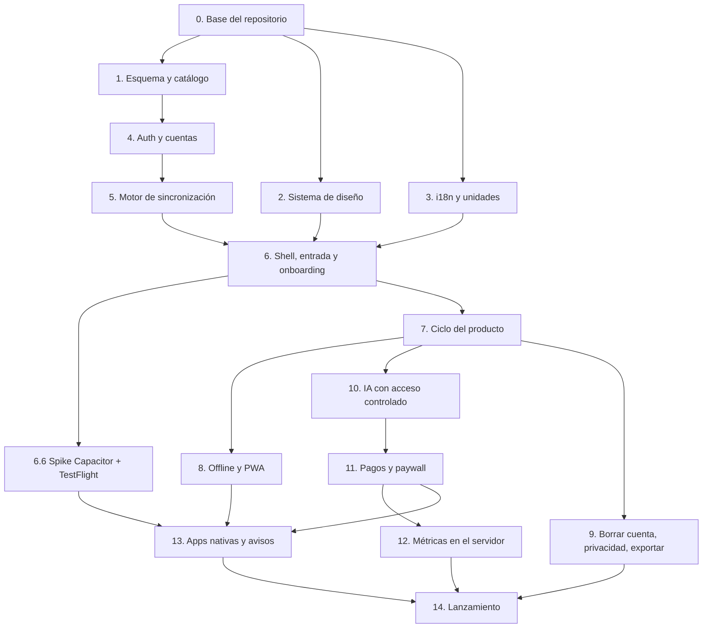

# MealPlan, el producto: Plan de implementación desde cero
_Status: Draft · Updated: 2026-11-13_
_Related: [spec](spec.md) · [tech](tech.md) · [app flow](appflow.md) · [design brief](design-brief.md) · [data model](data-model.md)_

## TL;DR
Orden de construcción de MealPlan **desde un repositorio vacío**, pensado para que un agente lo siga paso a paso sin mirar el código actual. Sale solo de los cinco documentos de producto: el PRD (`spec.md`), la tech design de plataforma (`tech.md`), el app flow (`appflow.md`), el brief de diseño (`design-brief.md`, con P1–P8) y el modelo de datos (`data-model.md`, con D1–D8).

La regla del orden: **primero lo que todo lo demás pisa** (repositorio, esquema, auth, sync, i18n y unidades, sistema de diseño), **después el ciclo del producto** en el orden en que lo vive el usuario (perfil → alimentos y recetas → Hoy → Plan → Cocina → Yo), **luego lo que cuesta dinero** (IA, pagos) y **al final lo que abre el producto** (métricas, apps nativas, avisos, lanzamiento). Lo que en el producto actual llegó tarde y costó rehacer (i18n, unidades, consentimiento, IA con sesión, sync por fila) aquí se construye bien desde el primer día.

Son 15 fases y unos 60 pasos. Cada paso es una unidad entregable (una PR) con sus tests.

## 1. Cómo usar este plan
- **Un paso = una PR.** Rama propia, tests incluidos, CI en verde. No se empieza un paso hasta que sus dependencias están mergeadas.
- **Antes de cada paso** el agente lee las secciones de los documentos que el paso cita. Las citas usan la forma `doc §sección` (p. ej. `data-model §4.5`).
- **Cada paso tiene un «Hecho cuando»:** criterios comprobables. Si un criterio del PRD aplica, se convierte en test.
- **Lo que este plan no decide** (librerías concretas, detalles de UI que esperan al diseño) está en §3 y se decide en el paso que lo necesita, preguntando al dueño del producto.
- **Next.js:** la versión es Next 16 y tiene cambios incompatibles con lo que un modelo conoce de memoria. Antes de escribir código de Next hay que leer la guía correspondiente en `node_modules/next/dist/docs/` y respetar los avisos de deprecación.

## 2. Qué documento manda si se contradicen
Los documentos se escribieron en orden y los posteriores corrigen a los anteriores. Precedencia, de mayor a menor:

1. **Decisiones explícitas del dueño del producto:** D1–D8 (data-model §9), P1–P8 (design-brief, Decisiones), D1–D5 del app flow, F1–F4 (tech, Spec feedback).
2. `data-model.md`
3. `appflow.md`
4. `design-brief.md`
5. `tech.md`
6. `spec.md`

Contradicciones ya conocidas y cómo se resuelven:

| Tema | Dice | Manda |
|---|---|---|
| «Rellenar semana» | PRD R15: es de pago, con IA | **F1:** es gratis y sin IA (búsqueda local). Desaparece el caso límite de R14 sobre dejar la semana a medias |
| Tablas de consentimiento y recuperación | tech: `consents`, `password_resets` | data-model: `consent_events` (inmutable) + vista `user_consents`; `auth_tokens` con `purpose` |
| Almacenamiento de datos del usuario | tech: `user_data`, un JSON por clave | data-model D1: tablas normalizadas por entidad |
| Métricas | tech: el cron lee `user_data` | El cron calcula con SQL sobre las tablas normalizadas |
| Hash de contraseñas | (actual: scrypt) | data-model: argon2id (m=19 MiB, t=2, p=1) |
| Nombres de las pantallas | PRD: Diario, Perfil, Compra | app flow: **Hoy, Plan, Cocina (Lista \| Despensa), Recetas, Yo** |
| Uso anónimo | — | app flow D4: hay que tener cuenta antes de usar la app |
| `ai_usage.feature` | — | Solo `recipe_generate`, `recipe_import`, `receipt_scan` (F1) |

## 3. Decisiones que este plan deja abiertas
Se deciden en el paso indicado, preguntando. La columna «Propuesta» es lo que el agente propone por defecto.

| # | Decisión | Paso | Propuesta |
|---|---|---|---|
| A1 | Estructura del repositorio | 0.1 | Dos proyectos Next (`app/` export estático, `server/` API en Vercel) más `shared/` con tipos, validación, unidades y cálculos puros importado por ambos |
| A2 | Herramienta de migraciones SQL | 1.1 | SQL plano versionado (`server/db/migrations/NNNN_*.sql`) con un runner propio mínimo |
| A3 | Almacén local del cliente | 4.1 | IndexedDB, una «tabla» por tabla ⇅ (localStorage no da para filas ni índices) |
| A4 | Validación de esquemas | 0.1 | Una librería de esquemas compartida en `shared/` (cliente y servidor validan lo mismo) |
| A5 | Librería de gráficas | 7.6 | Una ligera compatible con el export estático, o SVG propio |
| A6 | Envío de avisos (R18) | 13.1 | data-model §8 lo deja a su tech design: notificaciones locales en nativo + Web Push desde cron en web |
| A7 | Fuentes de datos del catálogo | 1.3 | CIQUAL (es) + USDA (en) para genéricos; Open Food Facts bajo demanda por código de barras |

**Preguntas abiertas de producto** (bloquean solo lo que se indica; mientras tanto se usan constantes de configuración):
- Usos de IA al mes del plan de pago (PRD R14) → bloquea el valor de `AI_MONTHLY_LIMIT` en el paso 10.2, no el código.
- Importes en las tiendas con la comisión (PRD R15) → bloquea la configuración de productos en 11.1.
- Fotos de las recetas semilla (design-brief) → bloquea las imágenes en 1.3; mientras, marcador con inicial (P4).
- ¿Se ofrece la prueba de 7 días al acabar el onboarding? (app flow) → afecta a 6.4 y 11.3.
- ¿La intro de 2–3 pantallas se queda? (app flow) → afecta a 6.3.

## 4. Mapa de fases

Fases que pueden ir en paralelo (archivos distintos): 1 ∥ 2 ∥ 3 después de 0; 8 ∥ 9 ∥ 10 después de 7.

---

## Fase 0. Base del repositorio
**Objetivo:** un repositorio donde cualquier paso posterior se puede construir, probar y desplegar.

### 0.1 Estructura y herramientas
- Monorepo con `app/` (Next 16, `output: "export"`), `server/` (Next 16, rutas API, Vercel) y `shared/` (A1). TypeScript estricto en los tres.
- Lint y formato comunes, alias de importación a `shared/`.
- `shared/` arranca con: tipos de las filas ⇅ (data-model §3–4), esquemas de validación (A4), generador de UUIDv7 y UUIDv5 (data-model §3 «Claves naturales»).
- **Hecho cuando:** `app` exporta una página vacía a `out/`, `server` responde `GET /api/health`, y ambos importan un tipo de `shared/`.

### 0.2 Tests y CI
- Tests unitarios en los tres paquetes, e2e de navegador contra `app` + `server` locales.
- CI en cada PR: lint, tipos, unitarios, build de `app` y `server`, e2e.
- **Hecho cuando:** la CI corre en una PR de prueba y falla si falla un test.

### 0.3 Entornos y secretos
- Neon: una base por entorno (dev, preview, prod). Vercel para `server` (y para servir el export web de `app`).
- Variables: `DATABASE_URL`, `SESSION_HMAC_SECRET` (claves de rate limit), `ANTHROPIC_API_KEY`, `RESEND_API_KEY`, `REVENUECAT_*`, `STRIPE_*`, `CRON_SECRET`, `APP_ORIGIN`, `API_ORIGIN`. Ninguna en el cliente salvo las públicas de RevenueCat.
- Dominios: la web y la API en el mismo sitio (`<dominio>` y `api.<dominio>`), requisito de la cookie `__Host-session` (data-model §6, D2).
- **Hecho cuando:** un deploy de preview tiene `app` y `server` hablando entre sí con su propia base.

---

## Fase 1. Esquema y catálogo
**Lee:** data-model §1–4, §4.4.

### 1.1 Runner de migraciones (A2)
- Migraciones SQL numeradas, idempotentes, aplicadas en orden y registradas en una tabla de control. Se ejecutan en el deploy del servidor.
- Extensiones: `citext`, `pg_trgm`.
- **Hecho cuando:** aplicar dos veces no cambia nada y la CI levanta una base vacía con todas las migraciones.

### 1.2 Esquema completo
Una migración por bloque, en este orden (respeta las FK):
1. Identidad y acceso: `users`, `sessions`, `auth_tokens`, `rate_limit_buckets`, `consent_events` + vista `user_consents` (§4.1).
2. Suscripción e IA: `entitlements`, `billing_events`, `ai_usage` (§4.2).
3. Sincronización: `sync_state`, `catalog_state` (§4.8).
4. Perfil y salud: `user_settings`, `health_profiles`, `nutrition_targets`, `user_allergens`, `food_preferences`, `body_measurements`, `meal_slots` (§4.3).
5. Alimentos y recetas: `foods`, `food_names`, `food_portions`, `seasonal_produce`, `recipes`, `recipe_texts`, `recipe_ingredients`, `recipe_marks`, `food_favorites` (§4.4).
6. Plan y Diario: `plan_items`, `diary_entries`, `day_logs` (§4.5).
7. Cocina: `shopping_items`, `pantry_items` (§4.6).
8. Avisos y métricas: `push_endpoints`, `metrics_daily` (§4.7).

Reglas que se aplican a todas: bloque de columnas ⇅ e índice `(user_id, rev)` (§3), `ON DELETE CASCADE` a `users` (principio 7), enumerados como `text` + `CHECK`, cantidades en métrico (principio 3), `date` para días (principio 4). Marcar en un registro de `shared/` qué tablas son ⇅ y cuáles 🩺: lo usan el sync (5.x) y el borrado (9.1).
- **Hecho cuando:** un test de esquema comprueba, para cada tabla con `user_id`/`owner_id`, que borrar el usuario borra sus filas; y que cada tabla ⇅ tiene sus siete columnas e índice.

### 1.3 Catálogo semilla (A7)
- Script de importación reproducible (no a mano) que carga `foods` (`owner_id NULL`) con `food_names` en `es` y `en`, `food_portions`, `allergens`, `category`, `shelf_life_days`, `density_g_ml`; `seasonal_produce` para `ES` (y `US` si hay datos); `recipes` semilla con `recipe_texts` en `es` y `en`, `recipe_ingredients` enlazados a `foods`, `meal_types`, macros por ración calculados de los ingredientes y alérgenos como unión.
- Cada alta o corrección sube `catalog_state.rev` y lo escribe en la fila (para el sync del catálogo, 5.2).
- Criterio R20: ninguna fila semilla sin su texto en inglés.
- **Hecho cuando:** un test recorre el catálogo y falla si falta un nombre en algún idioma, si una receta no cuadra sus macros con sus ingredientes o si un alérgeno de un ingrediente no está en la receta.

---

## Fase 2. Sistema de diseño
**Lee:** design-brief completo, especialmente §3, §5, §7 «Sistema de diseño», §10, §11. **Depende de:** los entregables 1–2 del brief (dirección visual y tokens en Claude Design, P8). Si aún no existen, se construye con tokens provisionales que respetan P1–P5 y se sustituyen después sin tocar componentes.

### 2.1 Tokens y tema
- Variables CSS para color (claro y oscuro), tipografía, espaciado, radios, elevación y movimiento (§5, §12). Primario verde salvia, acento terracota solo para caducidad y 💎, ámbar suave para «por encima», nunca rojo para el objetivo (P2).
- Figtree alojada en la app, cifras tabulares (P3); escalado del sistema hasta 200 % (§10).
- Tema `system` · `light` · `dark` (P5), leído de `user_settings.theme` cuando exista; antes del registro, de la preferencia local.
- `prefers-reduced-motion` sustituye animaciones por fundidos (§10).
- **Hecho cuando:** una página de muestra enseña todos los tokens en claro y oscuro y un test de contraste comprueba 4,5:1 en texto y 3:1 en gráficos (WCAG 2.2 AA).

### 2.2 Componentes base
Con todos sus estados (normal, pulsado, desactivado, cargando, error, sin conexión) y objetivos táctiles ≥ 44 pt / 48 dp (§7, §10):
- Navegación: barra de pestañas inferior, barra lateral ≥ 1024 px (P6), cabecera con selector de día, control segmentado, indicador de sincronización / sin conexión.
- Feedback: toast con deshacer, aviso no bloqueante, diálogo destructivo, estado vacío, esqueleto, «Necesita conexión».
- Contenido y entrada: hoja inferior, fila deslizable con alternativa visible al gesto, chips, insignia 💎, campos, interruptores, selector de cantidad (pasos rápidos ½/1/2 raciones y 50/100/150 g + teclado numérico).
- Los componentes de datos (anillo de kcal, barras de macros, gráficas) se construyen en la fase 7 junto a la pantalla que los usa.
- **Hecho cuando:** cada componente tiene un ejemplo por estado, en español e inglés con el texto más largo, y pasa una auditoría de accesibilidad automática.

---

## Fase 3. Idioma y unidades desde el primer día
**Lee:** tech «Traducción y unidades» (opción A), PRD R20–R21 y sus criterios, design-brief §9, data-model principio 3.

### 3.1 Capa de traducción
- `t(key, params)` con diccionarios `es` y `en` en `app/src/i18n/`, plurales y formato de números y fechas por idioma (1.250 kcal / 1,250 kcal).
- **Regla para todo el plan:** ningún texto visible se escribe en un componente; todo pasa por `t()`. Un test de CI busca literales en los componentes y falla.
- El idioma vive en `user_settings.locale`; antes del registro, en preferencia local (por defecto el del sistema).
- Nombres de alérgenos, franjas `preset` y categorías: claves del diccionario (data-model §3 «Tipos», §4.3).
- Resolución de nombres del catálogo por `food_id`/`recipe_id` en el idioma elegido, con `name_snapshot`/`customName` de respaldo; los productos de Open Food Facts y los datos del usuario no se traducen (F4).
- **Hecho cuando:** cambiar el idioma cambia toda la UI al momento sin recargar, y un test comprueba que no queda ninguna clave sin traducir en `en`.

### 3.2 Unidades
- `shared/units.ts`: conversión solo al mostrar e introducir (g↔oz, kg↔lb, cm↔in, ml↔fl oz). Se guarda en métrico sin redondear (3,5 oz → 99,22 g) y se redondea solo al mostrar (tech «State & edge cases»).
- **Hecho cuando:** tests de ida y vuelta sin deriva y un test de que los macros calculados son iguales en métrico e imperial (criterio de R21).

---

## Fase 4. Autenticación y cuentas
**Lee:** data-model §4.1, §6; app flow F-1, F-2; tech «APIs». Sin este bloque no se escribe ningún dato del usuario.

### 4.1 Núcleo de sesión
- Middleware del servidor: hash del token → `sessions` vigente → `users.status = active`. Cookie `__Host-session` en la web, `Authorization: Bearer` en nativo (D2). Token opaco de 32 bytes, SHA-256 en la base.
- CSRF: las peticiones que cambian algo exigen `Content-Type: application/json` y `Origin` permitido.
- Caducidad: inactividad 90 días, absoluta 1 año; `last_used_at` como mucho una vez al día.
- Rate limit compartido en `rate_limit_buckets` con claves HMAC (nunca IP ni email en claro).
- **Regla para todo el plan:** ninguna ruta que lea o escriba datos del usuario, ni ninguna ruta de IA, existe sin pasar por este middleware (es la lección de la tarea 0 de tech).
- **Hecho cuando:** tests de sesión válida, revocada, caducada, usuario `deleting`, y de que una petición sin `Origin` permitido se rechaza.

### 4.2 Registro (R10, R13)
- `POST /api/auth/register` según el diagrama de data-model §6: una transacción crea `users`, `consent_events` (`privacy_policy`, `health_data`), `user_settings`, `entitlements(free)`, `sync_state`, `sessions` y `auth_tokens(verify_email)`; envía el email con Resend. Sin código de invitación (R10). Contraseña 10–128 caracteres. `409 email_taken`.
- Si no llega `health_consent: true`, no se crea nada (F3).
- **Hecho cuando:** e2e del criterio de R10 y test de que sin consentimiento de salud no hay fila en `users`.

### 4.3 Entrar, salir, sesiones
- `POST /api/auth/login` (email o `legacy_username`), con hash ficticio si no existe y error único; rehash si los parámetros son viejos.
- `POST /api/auth/logout`, `GET /api/auth/sessions`, `DELETE /api/auth/sessions/:id`.
- **Hecho cuando:** el tiempo de respuesta no distingue usuario inexistente de contraseña mala (test de humo) y cerrar una sesión invalida solo esa.

### 4.4 Email: verificar, recuperar, cambiar (R11, D4)
- `verify`, `verify/resend`, `forgot` (siempre `202`), `reset` (revoca todas las sesiones y verifica el email), `email` (cambio con aviso al viejo), `password` (revoca las demás).
- Token en el fragmento `#` del enlace; pedir uno nuevo invalida los anteriores del mismo `purpose`. Reset 1 h, verificar y cambiar 24 h.
- La verificación no bloquea (D4): aviso en Hoy.
- **Hecho cuando:** e2e completo de F-2 con un buzón de pruebas y tests de token usado, caducado y sustituido.

### 4.5 `GET /api/me`
- Usuario (email, verificado), `entitlements`, uso de IA del mes con fecha de reinicio (0 hasta la fase 10), estado de los consentimientos frente a la versión vigente de la política. Siempre del servidor, nunca de caché (app flow F-7).
- **Hecho cuando:** devuelve `consent_required` si la versión de la política vigente es más nueva que la aceptada.

---

## Fase 5. Motor de sincronización
**Lee:** data-model §3 «Columnas de sincronización», §5; PRD R8, R16; app flow «Estados transversales».

### 5.1 Servidor: push y pull
- `GET /api/sync?since=&catalog_since=` paginado por `rev`, con lápidas. `410` si el cursor es más viejo que la purga (180 días).
- `POST /api/sync`: transacción que bloquea `sync_state`, rechaza filas 🩺 sin `health_data` vigente (`403 consent_required`, aplica el resto), comprueba propiedad y FK (solo filas propias o del catálogo), resuelve conflictos por `updated_at` acotado a `now()` (D8) devolviéndolos en `conflicts`, asigna `rev`.
- Claves naturales con UUIDv5 para que dos dispositivos offline converjan (data-model §3).
- **Hecho cuando:** tests de dos dispositivos que editan la misma fila offline, de filas 🩺 sin consentimiento, de FK a una fila de otro usuario, de lápidas y de `410`.

### 5.2 Cliente: almacén local y cola (A3)
- Almacén local con una colección por tabla ⇅ y las del catálogo; toda escritura de la UI va al almacén local y a una cola de salida (outbox). La UI nunca espera a la red.
- Bucle de sync: empuja la cola, tira desde el cursor, aplica, guarda cursores (usuario y catálogo). Reintento con espera creciente y timeout del sondeo (R16).
- Filtro de consentimiento: sin `health_data` vigente, las tablas 🩺 se quedan en local (R13, F3).
- Conflictos → aviso no bloqueante «Se han combinado cambios de otro dispositivo» con detalle en Yo › Datos.
- `401` → pantalla Entrar conservando los datos locales.
- Indicador discreto de cambios pendientes en la cabecera.
- **Hecho cuando:** e2e con dos navegadores: un cambio offline en uno aparece en el otro al reconectar; un conflicto se resuelve y se avisa.

### 5.3 API de datos del cliente
- Una capa de repositorios en `app/` (consultas por día, por semana, por franja; escrituras que rellenan `id`, `created_at`, `updated_at`, `device_id`) que es lo único que usan las pantallas. Así ninguna pantalla conoce el sync.
- **Hecho cuando:** las pantallas de la fase 7 no importan nada del motor de sync.

---

## Fase 6. Shell de la app, entrada y onboarding
**Lee:** app flow «Mapa de pantallas», F-1, F-3; design-brief §6, §8 «Consentimientos».

### 6.1 Shell y navegación
- Cinco pestañas Hoy · Plan · Cocina · Recetas · Yo, Hoy como inicio (app flow D1, D2). Barra inferior en móvil, lateral ≥ 1024 px (P6). Áreas seguras y barra de estado respetadas desde el principio (R17).
- Rutas compatibles con el export estático (sin rutas dinámicas de servidor).
- **Hecho cuando:** las cinco pestañas navegan en 320 px y en 1280 px sin scroll horizontal.

### 6.2 Bienvenida, idioma y unidades
- Primera pantalla: idioma y unidades, por defecto los del sistema; enlace a la política de privacidad (accesible antes de registrarse, criterio de R13).

### 6.3 Crear cuenta, entrar y recuperar
- Intro de 2–3 pantallas (pendiente de la pregunta abierta), Crear cuenta (email, contraseña, ✓ política), pantalla de consentimiento de salud con su explicación; si no acepta, no se crea la cuenta y se explica por qué (F-1). Entrar y «¿Olvidaste la contraseña?» (F-2).

### 6.4 Onboarding (R1)
- Objetivo: calcular (Mifflin-St Jeor en `shared/`, con el nivel de actividad y la meta) o los del nutricionista (proteína como rango). Escribe `health_profiles` y la primera fila de `nutrition_targets` con `effective_from = hoy` (D5).
- Comidas del día → `meal_slots` (presets traducibles + propias).
- Alergias (14 de la UE, exclusión estricta), dieta y gustos → `user_allergens`, `health_profiles.diet`, `food_preferences`.
- Resumen de objetivos + tolerancia de «cumplido» (por defecto 10 %).
- Consentimiento de analítica con «Ahora no» del mismo peso que «Sí» → `POST /api/consents`.
- Llega a Hoy vacío con «Planifica tu semana» · «Registra tu primera comida».
- **Hecho cuando:** e2e de F-1 completo, y test de que la fórmula da el resultado esperado para casos de referencia.

### 6.5 Re-consentimiento (F-3)
- Al abrir, si `/api/me` dice que la política vigente es más nueva, pantalla de consentimiento; «Ahora no» deja usar la app en local sin subir tablas 🩺.
- (El aviso de «añade un email» de F-3 solo aplica a cuentas heredadas: fase 14.3.)

### 6.6 Spike de Capacitor y TestFlight (riesgo de tech)
- Empaquetar el export con Capacitor para iOS y Android con el shell, login con *bearer* en Keychain/Keystore y una pestaña real. Subir a TestFlight y a la pista interna de Play.
- Objetivo: detectar pronto el rechazo por la guideline 4.2 de Apple y los problemas de sesión en WebView antes de construir todo el producto encima (tech «Risks»).
- **Hecho cuando:** la build pasa la revisión de TestFlight externa o se conoce el motivo del rechazo; si hay rechazo, se para y se decide con el dueño del producto antes de seguir con la fase 13.

---

## Fase 7. El ciclo del producto
**Lee:** app flow §Pestañas, «Hoja Añadir comida», F-4 a F-8, «Estados transversales»; design-brief §8 por área; data-model §4.3–4.6; las specs de feature enlazadas en PRD R1–R9 para el detalle de comportamiento.

Orden: lo que el usuario necesita antes para lo siguiente. Los requisitos `Could` que el esquema ya soporta se construyen dentro de su pantalla en lugar de dejarlos para después (se marcan entre corchetes).

### 7.1 Cálculos compartidos (`shared/`)
- Macros de una cantidad de alimento (por 100 g, porciones, densidad), de N raciones de receta, totales de un día.
- Objetivo de un día = fila de `nutrition_targets` con mayor `effective_from ≤ día` (D5).
- «Día cumplido» con la tolerancia (R1, días que cumplen), medias de adherencia.
- Caducidad: «caduca pronto» (≤ `expiry_warning_days`), «caducado», «caduca en X días».
- Son funciones puras: las usan la app y el cron de métricas (fase 12), así ambos cuentan igual.
- **Hecho cuando:** tests con casos límite (proteína en rango, día sin objetivo, tolerancia 0).

### 7.2 Alimentos: búsqueda y código de barras
- Búsqueda local sobre el catálogo sincronizado en el idioma elegido (y búsqueda trigram en el servidor si el catálogo no cabe entero en el dispositivo; decidir en el paso según tamaño).
- Código de barras: escáner con librería empaquetada, sin CDN (R17, #93); `GET /api/foods/barcode/:code` busca en `foods` y si no, en Open Food Facts y lo cachea como catálogo. Sin conexión: solo productos ya cacheados.
- Alimentos propios y comidas «a mano» guardadas (`foods` con `owner_id`), favoritos (`food_favorites`).
- **Hecho cuando:** un código conocido y uno nuevo se resuelven; sin red, el nuevo muestra «Necesita conexión».

### 7.3 Recetas (R5)
- Lista con búsqueda, filtros (temporada, alérgenos, valoración, favoritos, propias), orden; tarjeta con foto o marcador con inicial (P4).
- Detalle: ingredientes escalados a las raciones, macros por ración, aviso de alérgenos siempre visible, valoración 1–5 y favorito (`recipe_marks`). Acciones «Añadir al Plan» y «Registrar ahora».
- Receta propia (ingredientes enlazados a alimentos, macros calculados).
- Exclusión estricta de alérgenos declarados en búsquedas y sugerencias (estado transversal «Alergias»).
- Temporada (R5) desde `seasonal_produce` según región y mes.
- Importar desde URL **sin IA** (datos estructurados de la página); el camino con IA llega en 10.3.
- **Hecho cuando:** una receta con un alérgeno declarado no aparece en ninguna lista ni sugerencia.

### 7.4 Hoy y la hoja Añadir comida (R2)
- Hoy: cabecera con selector de día y tira semanal de días que cumplen; progreso del día (kcal y macros frente al objetivo con banda de tolerancia, sin rojo); franjas con lo registrado (editar gramos, repetir, borrar) y «+ Añadir»; agua y fibra (`day_logs`); avisos de caducidad que llevan a la Despensa filtrada.
- Hoja Añadir comida con la franja preseleccionada: Recientes (por frecuencia en la franja, [R28]), Favoritos, Buscar (recetas + alimentos con marca de tipo, [R26]), Código de barras, A mano (con combinar varios alimentos en un plato, [R25]). Recientes y favoritos se registran con un toque; la cantidad se edita después.
- `diary_entries` congela los totales al registrar (principio 5) y guarda `origin`, `logged_at`, `name_snapshot`; azúcar y sodio opcionales [R24].
- Menú del día: copiar el día a otra fecha con `copy_run_id` y deshacer la copia [R27].
- **Hecho cuando:** registrar un reciente son ≤ 3 toques desde Hoy (design-brief §1) en un e2e, y editar un alimento del catálogo no cambia entradas pasadas.

### 7.5 Plan (R3)
- Rejilla semana × franjas, navegar entre semanas con botones y deslizar [R29]; macros planificados por día frente al objetivo.
- En una franja: receta con raciones o alimento con gramos/porciones; sobras (`leftover_of_id`) y batch cooking (`cooks_servings`) distinguibles a la vista; mover y borrar. La hoja Añadir comida, abierta desde el Plan, **asigna** en lugar de registrar.
- **Copiar semana anterior** y **Rellenar semana** (gratis y sin IA, F1): búsqueda local que usa `meal_types`, los objetivos del día, alérgenos (exclusión), dieta y gustos; ambos con `fill_run_id` para deshacer el lote.
- **Registrar** lo planificado con un toque desde Hoy (aparece en la franja de 7.4 como «Planificado») y desde la hoja; la entrada guarda `plan_item_id`.
- **Hecho cuando:** e2e de F-4 hasta «Generar lista» y test de que Rellenar semana nunca propone un alérgeno declarado.

### 7.6 Cocina: Lista y Despensa (R4, R6, R19, R30)
- Generar la lista desde la semana del Plan: suma ingredientes (las sobras no suman), descuenta la Despensa activa, agrupa por categoría; regenerar sustituye las líneas `plan` sin marcar y respeta las manuales.
- Marcar comprado → «Pasar a la Despensa», infiriendo `expires_on` con `shelf_life_days` o preguntándolo.
- Despensa por categoría con chips «Caduca pronto» / «Caducado» y «caduca en X días» en la tarjeta [R30]; «Caduca pronto → recetas» que aprovechan lo que caduca.
- Quitar → «Consumido» / «Tirado», con `removed_at` y `removal_outcome` (R19); deslizar muestra las dos opciones.
- **Hecho cuando:** criterio de R19 como test, y la Lista es usable sin conexión (e2e offline).

### 7.7 Yo: progreso y ajustes (R1, R7)
- Progreso: peso y medidas (`body_measurements`) con gráfica de tendencia (media móvil, A5), «+ Nueva medición», medias de adherencia e histórico semanal; resumen textual de cada gráfica para lectores de pantalla.
- Ajustes: objetivos (nueva fila de `nutrition_targets` con fecha, nunca sobrescribir), comidas del día (archivar, no borrar), alergias, dieta y gustos, tolerancia, idioma y unidades, tema, avisos (interruptores; el envío llega en 13.3), privacidad (política, analítica activable y desactivable, salud informativo), cuenta (email, contraseña, sesiones abiertas, cerrar sesión). Suscripción, Datos y Borrar cuenta se completan en 11 y 9.
- **Hecho cuando:** cambiar los objetivos hoy no cambia qué días de la semana pasada cumplieron.

---

## Fase 8. Offline y PWA (R9, R17)
**Lee:** app flow «Estados transversales: Sin conexión»; PRD R9, R17.

### 8.1 Service worker y manifest
- Precarga del export estático, actualización controlada (avisar y recargar, sin quedarse en una versión vieja), manifest instalable con iconos.
- **Hecho cuando:** con la red cortada la app abre en Hoy con los datos del dispositivo.

### 8.2 Estados sin conexión
- Todo funciona en local salvo IA, código de barras nuevo, importar URL, login y sync: se ven desactivados con «Necesita conexión» (design-brief principio 6).
- **Hecho cuando:** e2e offline recorre las cinco pestañas sin errores y cada acción que necesita red lo dice.

---

## Fase 9. Borrar la cuenta, privacidad y datos
**Lee:** data-model §6 «Borrar la cuenta», D6; app flow F-9; PRD R8, R12.

### 9.1 Borrar la cuenta (R12)
- `DELETE /api/auth/account {password}`: `status = deleting`, baja del cliente en RevenueCat y Stripe (cuando existan, fase 11; hasta entonces, no-op), `DELETE FROM users` en cascada, `204`. El cliente borra su copia local; los demás dispositivos reciben `401`.
- UI con fricción deliberada: qué se pierde, que la suscripción de la tienda se cancela aparte, contraseña y confirmación.
- **Hecho cuando:** test del criterio de R12 recorriendo **todas** las tablas del registro de 1.2.

### 9.2 Exportar e importar JSON (R8)
- En el cliente sobre la copia local; importar son upserts normales por el sync. Versión del formato en el archivo.
- **Hecho cuando:** exportar → borrar datos locales → importar deja el mismo estado.

### 9.3 Política de privacidad en la app
- Página de la política versionada, enlazada desde Bienvenida, Crear cuenta y Yo › Privacidad; cambiar la versión dispara el re-consentimiento de 6.5. El texto legal lo aporta el dueño del producto (fuera del código).

---

## Fase 10. IA con acceso controlado
**Lee:** data-model §4.2 `ai_usage`, `entitlements`; tech «APIs» (`requireAiAccess`); app flow F-7; PRD R14, R15.

### 10.1 `requireAiAccess`
- Antes de cada llamada a Claude: sesión válida → `entitlements` con acceso (`trial`/`active`/`grace` y periodo vigente) o `402` → bloqueo de la fila de `entitlements` y conteo del mes UTC (`succeeded` + `reserved` < 5 min) o `429` con `resetsAt` → fila `reserved`. Tras la llamada, `succeeded` con modelo, tokens y coste, o `failed` (no cuenta).
- Sin caché en el cliente: el estado viene de `/api/me` y de la propia respuesta.
- **Hecho cuando:** tests de sin plan, prueba, límite alcanzado, mes nuevo y dos llamadas simultáneas con un solo uso libre.

### 10.2 Cliente de Claude
- Módulo único en `server/` para las tres funciones, con el modelo vigente configurable y límite `AI_MONTHLY_LIMIT` configurable (pregunta abierta de R14). Antes de escribirlo, leer la documentación actual de la API de Claude.
- Ninguna salida de IA se guarda sin pasar por la validación de `shared/`.

### 10.3 Las tres funciones 💎
- **Generar receta** según perfil (objetivos, alergias, dieta, gustos) y despensa → `recipes` con `origin = ai`.
- **Importar receta desde URL** cuando la página no trae datos estructurados → `origin = url`, enlazando ingredientes a `foods` y dejando `raw_text` donde no se pueda.
- **Escanear ticket**: foto → productos detectados → pantalla de revisión → `pantry_items` con `origin = receipt`.
- Si una receta de IA o URL contiene un alérgeno declarado, se muestra el aviso (estado transversal «Alergias»).
- **Hecho cuando:** con el plan gratis las tres muestran el paywall (aún de prueba) en lugar de llamar; con premium funcionan y gastan un uso.

---

## Fase 11. Pagos y paywall (R15)
**Lee:** tech «Pagos» (opción A); data-model §4.2; app flow F-7, Yo › Suscripción; design-brief §8 «Paywall».

### 11.1 RevenueCat y Stripe
- Productos mensual y anual con prueba de 7 días (importes de R15, pendientes de la pregunta de las tiendas), una vez por cuenta (`trial_used`). `users.id` es el `app_user_id`.
- Web: Stripe a través de RevenueCat. Nativo: IAP con el SDK (se conecta en 13.1).

### 11.2 Webhook
- `POST /api/billing/webhook`: firma verificada, idempotente por `billing_events.event_id`, actualiza `entitlements` (única fuente de verdad). «Restaurar compras» consulta la API de RevenueCat.
- **Hecho cuando:** tests de firma inválida, evento repetido, renovación, cancelación, expiración y problema de cobro.

### 11.3 Paywall y suscripción
- Paywall: qué incluye en tres puntos, mensual y anual con el ahorro real, prueba con la fecha del cobro, «Restaurar compras», cerrar siempre visible; al pagar o empezar la prueba vuelve y ejecuta la función (F-7).
- Aviso de límite: «Has usado tus N usos; vuelven el 1 de MES».
- Yo › Suscripción: plan, uso del mes con fecha de reinicio, gestionar o cancelar, restaurar.
- **Hecho cuando:** criterios de R14 y R15 como e2e, y ninguna pantalla gratis tiene un bloqueo que no sea 💎 (design-brief §1).

---

## Fase 12. Métricas en el servidor (R23)
**Lee:** PRD «Success metrics», R23; data-model §4.7; tech «Métricas» (opción A).

### 12.1 Cron diario
- Ruta protegida con `CRON_SECRET`, una ejecución al día. Solo usuarios cuyo último `analytics` es `granted`.
- Calcula con SQL y las funciones de 7.1: días registrados por semana (mediana), días dentro de objetivo, franjas planificadas antes del lunes, ítems tirados sobre quitados (sin contar `removal_outcome NULL`). Escribe agregados en `metrics_daily`, sin `user_id`.
- En la misma ejecución: purga de ventanas de `rate_limit_buckets`, de lápidas de más de 180 días y de `auth_tokens` caducados.
- **Hecho cuando:** test de que un usuario con `health_data` pero sin `analytics` no entra en ningún agregado (criterio de R23).

---

## Fase 13. Apps nativas y avisos (R22, R18)
**Lee:** tech «Apps nativas»; design-brief §6; data-model §4.7, §6 «Transporte de la sesión»; app flow F-10. **Depende de:** el resultado del spike 6.6.

### 13.1 Apps de iOS y Android
- Capacitor sobre el export: plugins de cámara (código de barras y ticket, con su estado de permiso denegado), almacenamiento seguro del token, hápticos discretos, gesto atrás y botón atrás, teclado numérico, enlaces universales / app links para verificar y restablecer.
- IAP con el SDK de RevenueCat.
- **Hecho cuando:** criterios de R22: cada función de R1–R9 funciona en nativo y un cambio en nativo aparece en la web de la misma cuenta y al revés.

### 13.2 Endpoints de avisos
- Registro y baja de `push_endpoints` por sesión (cerrar sesión deja de avisar a ese dispositivo).

### 13.3 Recordatorios y caducidades (A6)
- Recordatorios de comidas a `meal_slots.reminder_time` y avisos de caducidad, según `user_settings`. Al tocarlos: Hoy en esa franja, o Despensa filtrada por «Caduca pronto» (F-10).
- **Hecho cuando:** un aviso de prueba llega en web, iOS y Android y abre la pantalla correcta.

---

## Fase 14. Lanzamiento
**Lee:** PRD «Orden de entrega de los Should», «Risks & dependencies»; design-brief §13–14.

### 14.1 Prueba con usuarios y accesibilidad
- Prueba de usabilidad del design-brief §14 con 5 personas (F-1 y F-5) y revisión de contraste y tamaños en claro y oscuro. Lo que salga, se arregla antes de abrir.

### 14.2 Legal y tiendas
- Asesoría legal sobre RGPD y datos de salud antes de abrir el registro (PRD «Risks»). Fichas de App Store y Google Play: icono, capturas, declaración de datos de salud. Nombre y logotipo revisados antes de publicar (P7).

### 14.3 Migración de las cuentas actuales (solo si se sustituye la app existente)
- Importar los usuarios actuales como cuentas heredadas (`legacy_username`, `email NULL`, data-model §7) y transformar sus datos al esquema normalizado. Aviso en Hoy para añadir email (F-3). Sin `health_data` vigente, sus datos 🩺 se quedan en local hasta que consienten.
- **Hecho cuando:** una cuenta heredada de prueba entra, ve sus datos, añade su email y recupera la contraseña.

### 14.4 Abrir
- Orden del PRD: con privacidad (fase 9), borrado (9.1), límites de IA (10) y recuperación (4.4) en producción, se abre el registro, se activan los pagos y se publican las apps. Las métricas empiezan a tener línea base desde aquí.

---

## 5. Fuera de este plan
- **Vista para nutricionistas (R31):** necesita su propia spec; data-model §8 anticipa una tabla `care_links`.
- **Login social (D3):** no está en v1; si se añade, Apple exige su botón en iOS (guideline 4.8).
- **Cifrado propio de columnas de salud (D7):** descartado en v1.
- **Más idiomas que español e inglés:** la capa de la fase 3 lo permite, pero no se entrega.

## 6. Cobertura del PRD
| Req | Pasos |
|---|---|
| R1 | 6.4, 7.1, 7.7 |
| R2 | 7.2, 7.4 |
| R3 | 7.5 |
| R4 | 7.6 |
| R5 | 7.3, 10.3 |
| R6 | 7.6, 10.3 |
| R7 | 7.7 |
| R8 | 5.x, 9.2 |
| R9 | 8.1, 8.2 |
| R10 | 4.2, 14.4 |
| R11 | 4.4 |
| R12 | 9.1 |
| R13 | 4.2, 5.1, 5.2, 6.3, 6.5, 9.3 |
| R14 | 10.1, 11.3 |
| R15 | 10.3, 11.x |
| R16 | 5.x |
| R17 | 6.1, 7.2, 8.1 |
| R18 | 13.2, 13.3 |
| R19 | 7.6, 12.1 |
| R20 | 1.3, 3.1 |
| R21 | 3.2 |
| R22 | 6.6, 13.1 |
| R23 | 6.4, 12.1 |
| R24 | 7.4 |
| R25 | 7.4 |
| R26 | 7.4 |
| R27 | 7.4 |
| R28 | 7.4 |
| R29 | 7.5 |
| R30 | 7.6 |
| R31 | Fuera (§5) |
